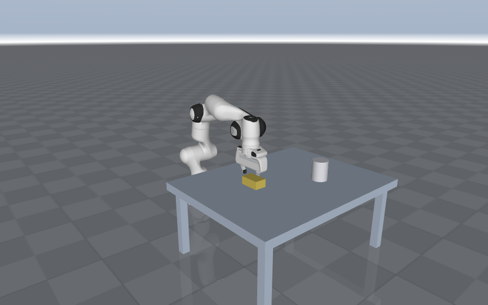

# FMR robot learning labs

Hands-on labs for the **[Foundation Models for Robotics](https://www.youtube.com/@FoundationModelsForRobotics)** video series and the free book **[Action Models for Robot Learning](https://action-models-book.vercel.app)**. One lab per lesson, simulated in [MuJoCo](https://github.com/google-deepmind/mujoco), with two arms to choose from: a **Franka FR3** (a real research arm) and **FMR-6** (the six-axis arm drawn in the videos).



## Run a lab

**In the browser (no install):** open the lab's Colab link below and run the cells top to bottom.

**On your machine** (Python 3.10+, no GPU needed for Tier 1):

```bash
git clone https://github.com/kandapagari/fmr-robot-learning-labs.git
cd fmr-robot-learning-labs
pip install -e ".[dev]"          # or: uv venv && uv pip install -e ".[dev]"
pytest -q                        # checks the model and the numbers used in the videos
jupyter lab labs/s0e1-drift/s0e1_drift.ipynb
```

Videos in the notebooks use ffmpeg if it's installed (Colab has it); without it you get still frames instead. On a headless Linux machine set `MUJOCO_GL=egl` (NVIDIA) or `MUJOCO_GL=osmesa` (CPU) before rendering.

## Labs

| Lesson | Lab | Tier | Status |
|---|---|---|---|
| S0E1 · [Why a Robot Isn't a Chatbot With Arms](https://youtu.be/bN-Yv_gUcMM) | [Small errors don't stay small](labs/s0e1-drift) · [Colab](https://colab.research.google.com/github/kandapagari/fmr-robot-learning-labs/blob/main/labs/s0e1-drift/s0e1_drift.ipynb) | 1 | ready |
| S0E2 · The four families of action models | coming with the lesson | 1 | planned |
| A1–A5 · Frames, rotations, kinematics, IK, control | FMR-6 transforms, gimbal lock, Jacobian, IK, PID | 1 | planned |
| A8 · Teleop | Record 50 demos in sim, save in LeRobot format | 1–2 | planned |
| C3–C7 · Behaviour cloning to Diffusion Policy | BC, DAgger, ACT, Diffusion Policy on your demos and Push-T | 2 | planned |
| D, E · VLAs | Evaluate and fine-tune open VLAs (LIBERO, your own demos) | 2 (GPU) | planned |

**Tiers.** 1: MuJoCo + NumPy, laptop CPU or free Colab. 2: adds [LeRobot](https://github.com/huggingface/lerobot) (`pip install -e ".[learning]"`, installs PyTorch); VLA labs need a GPU. 3 (optional, later seasons): GPU-parallel simulators such as ManiSkill3.

## The arms

```python
import fmr6
robot = fmr6.Robot("table")                         # or fmr6.Robot() for the arm alone
pos, R = robot.tcp()                                 # tool tip (m) and orientation; tool axis = R[:, 0]
q = robot.ik([0.70, 0.05, 0.42], tool_dir=(0, 0, -1))
image = robot.render()

fr3 = fmr6.Robot("table", arm="fr3")                 # Franka FR3 + Franka Hand, same table; tool axis = R[:, 2]
```

**Franka FR3** (7 joints, Franka Hand gripper): the MuJoCo model from [MuJoCo Menagerie](https://github.com/google-deepmind/mujoco_menagerie), with the hand from Menagerie's Panda attached at the flange and a `tcp` site at Franka's tool centre point. [`tools/build_fr3.py`](tools/build_fr3.py) rebuilds it from a Menagerie checkout. Starts in Franka's home pose, hand pointing down.

**FMR-6:**
Six joints (J1 base yaw, J2 shoulder, J3 elbow, J4–J6 a spherical wrist that meets at one point) and a parallel gripper. Dimensions match the drawings in the videos: shoulder at 0.33 m, upper arm 0.58 m, forearm 0.56 m, wrist-to-fingertip 0.262 m. The model is in [`fmr6/assets/fmr6.xml`](fmr6/assets/fmr6.xml), and everything in `fmr6/robot.py` is short enough to read in one sitting.

## Contributing

Found a bug or a confusing step? Open an issue with the lab name. Every push runs the unit tests and executes every notebook headless ([workflow](.github/workflows/labs.yml)).

## License

Code: MIT. FMR-6 model (`fmr6/assets/*.xml`): CC BY 4.0, "FMR-6 by Foundation Models for Robotics". Franka FR3 and Franka Hand model and meshes (`fmr6/assets/fr3/`): Apache-2.0, from MuJoCo Menagerie, derived from Franka Robotics' `franka_description` ([licence](fmr6/assets/fr3/LICENSE)). Franka, FR3 and Franka Hand are trademarks of Franka Robotics GmbH; this project isn't affiliated with them.
